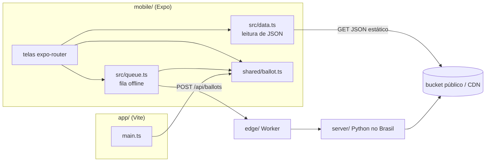
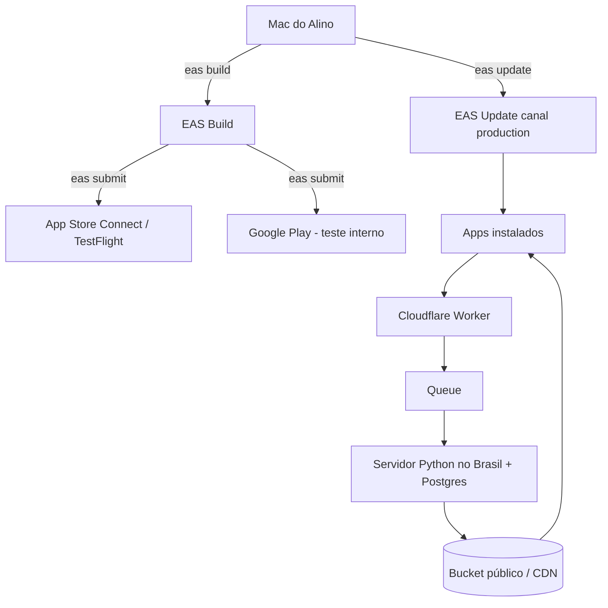

# Architecture Spine — Apuração Cidadã (mobile)

## Design Paradigm

**Cliente fino sobre um contrato de arquivos estáticos.** O app só faz três coisas: (1) ler e validar o QR (`shared/ballot.ts`), (2) enfileirar e enviar o texto do QR para `POST /api/ballots`, (3) exibir JSONs que o servidor já publicou (veredito, cobertura, divergências, resultados TSE). Nenhuma regra de negócio nova vive no app.



Direção de dependência: telas → `src/` → `shared/`. `shared/` não importa nada de plataforma. O app nunca fala com o servidor Python diretamente.

## Invariants & Rules

### AD-1 — Expo (React Native), não Capacitor [ADOPTED]
- **Binds:** todo o app mobile
- **Prevents:** duas bases de UI móvel e um app embrulhando um site (risco Apple 4.2)
- **Rule:** o app é `mobile/` em Expo + expo-router + EAS, no mesmo padrão do PsicoLX (`~/www/psicolx.com/apps/mobile`). O PWA `app/` continua no ar como cliente irmão; nenhum dos dois embute o outro.

### AD-2 — Uma só implementação do boletim
- **Binds:** leitura de QR, montagem das partes, cadeia SHA-512, validação
- **Prevents:** PWA, mobile e edge aceitando boletins diferentes
- **Rule:** `shared/ballot.ts` é a única fonte. O mobile importa o arquivo (Metro `watchFolders: ['../shared']`) e injeta o SHA-512 da plataforma (`expo-crypto`); o PWA continua com WebCrypto. É proibido copiar ou reescrever a lógica no app.

### AD-3 — Contrato do backend congelado [ADOPTED]
- **Binds:** rede
- **Prevents:** endpoints só do mobile e divergência de formatos
- **Rule:** o mobile usa exatamente os mesmos caminhos do PWA: `POST {API}/api/ballots` com o corpo JSON `texts: string[]` e `GET {DATA}/sections|aggregates|places|results|candidates|photos/...`. URLs vêm de `EXPO_PUBLIC_API_URL` e `EXPO_PUBLIC_DATA_URL`. Mudança de contrato muda os dois clientes e o servidor juntos.

### AD-4 — Veredito e números só do servidor [ADOPTED]
- **Binds:** telas de seção, cobertura, divergências, resultados
- **Prevents:** o app "projetar" ou somar boletins da porta
- **Rule:** o app exibe o status publicado (`waiting/identical/divergent/conflict`) e resultados TSE com o rótulo "· TSE". Localmente, ele só valida a integridade do QR antes de enviar.

### AD-5 — Anônimo no aparelho [ADOPTED]
- **Binds:** permissões, SDKs, privacidade da loja
- **Prevents:** um SDK de analytics, anúncios ou crash quebrar a promessa de anonimato
- **Rule:**
  - Única permissão: **câmera**. Sem localização, sem conta, sem push com identificador.
  - Nenhum SDK que colete identificador (Firebase Analytics, AdID, Sentry com usuário).
  - O rótulo de privacidade nas lojas declara "dados não vinculados a você", e só o texto do QR é enviado.
  - Foto do boletim, se houver, sai sem EXIF.

### AD-6 — Fila offline idempotente
- **Binds:** envio
- **Prevents:** perder boletins sem sinal ou duplicar contagem
- **Rule:** cada QR lido vira um item persistido no `localStorage` do `expo-sqlite` (mesmo código do PWA) com o mesmo payload do PWA e é reenviado até receber 2xx/4xx definitivo. A deduplicação é do servidor (hash do boletim); o app nunca decide que algo "já foi contado".

### AD-7 — Atualização no dia da eleição
- **Binds:** releases
- **Prevents:** um bug no dia 25 travado na revisão da loja
- **Rule:**
  - EAS Update no canal `production`, com `runtimeVersion.policy = appVersion`.
  - Mudança de JS sai por update; mudança nativa (novo módulo ou permissão) exige build de loja e está **congelada após 20/10**.

### AD-8 — Identidade
- **Binds:** lojas, deep links, tema
- **Prevents:** IDs trocados entre builds e cores fora da regra de neutralidade
- **Rule:**
  - Bundle/package `com.apuracaocidada.app`, scheme `apuracaocidada`, domínio `apuracaocidada.com` [ADOPTED].
  - Cores e fontes num único arquivo de tema (tokens). Nunca vermelho-PT nem verde-amarelo/azul-PL como marca; os dois candidatos com tratamento idêntico.

## Consistency Conventions

| Concern | Convention |
| --- | --- |
| Código | Inglês (identificadores, comentários, commits); textos de UI em pt-BR |
| Rotas | expo-router espelha o PWA: `(tabs)/section`, `(tabs)/coverage`, `(tabs)/divergences`, `(tabs)/about`, `scan`, `review`, `replay`, `candidate/[sq]` |
| Dados | Uma busca por arquivo, com memo; JSON de zona pequeno; imagens com tamanho fixo |
| Erros | Sem rede = item na fila + aviso; nunca bloquear o escaneamento |
| Textos | Nunca "fraude"; usar "divergência / a ser explicada" |

## Stack

| Name | Version |
| --- | --- |
| Expo SDK | 55 (padrão dos apps do Alino; docs já listam 57/58, verificar no `create`) |
| expo-router | ~55 |
| React Native | 0.83 |
| expo-camera (leitura de QR embutida) | do SDK |
| expo-crypto, expo-sqlite, expo-updates | do SDK |
| react-native-svg (mapa) | do SDK |
| EAS Build / Submit / Update | CLI ≥ 16 |

## Structural Seed

```text
resultado-eleicao-2026/
  shared/ballot.ts      # única lógica de boletim (AD-2)
  app/                  # PWA (continua)
  mobile/               # Expo (novo)
    app/                # rotas expo-router (convenção acima)
    src/data.ts         # leitura dos JSON públicos (porte de app/src/data.ts)
    src/queue.ts        # fila offline (AD-6)
    src/theme.ts        # tokens de cor/fonte (AD-8; design depois)
    assets/             # ícone, splash (logo depois)
    app.json, eas.json  # padrão psicolx
  edge/  server/        # inalterados (AD-3)
```



## Deferred

- **Logo, cores, tipografia e telas finais:** com as skills de design que o Alino vai trazer. Só preenchem `src/theme.ts` e `assets/`, sem mudar ADs.
- **Lembrete das 17h:** notificação local (sem servidor). Avaliar após v1; não exige identificador.
- **Bot de WhatsApp, zerésima, auditores:** fora do app.
- **Monorepo com pnpm workspace/turbo:** hoje basta o `watchFolders` do Metro; migrar só se surgir um segundo pacote compartilhado.
- **Tablet:** `supportsTablet: false` na v1.

## Open Questions

- **Submeter hoje:** a Apple rejeita app que não funciona (2.1). Sem o backend publicado, o envio de hoje deve ir só para **TestFlight / teste interno**. A versão pública vai depois do deploy.
